  

I’m Luís, a Security Engineer in Portugal. Most of my work is around SIEM integrations, documentation, and maintaining and upgrading the supporting architecture. Outside work, I’m currently practising on Hack The Box and pwn.college.

| | What I’m working on | |
| --- | --- | --- |
| `work` | SIEM integrations · documentation · architecture | [LinkedIn](https://www.linkedin.com/in/-luis-barros-/) |
| `labs` | Log collection, parsing, and use cases | [Projects](https://luisantoniio1998.github.io/labs/) |
| `practice` | Hack The Box · pwn.college | [HTB profile](https://profile.hackthebox.com/profile/019c3260-837c-701e-8430-ed2712df52a7) |

### `> from my notes`

- [Hack The Box — Logging](https://luisantoniio1998.github.io/writeups/hackthebox-logging/)
- [Hack The Box — CCTV](https://luisantoniio1998.github.io/writeups/htb-cctv-easy-linux/)
- [Hack The Box — Kobold](https://luisantoniio1998.github.io/writeups/htb-kobold/)
- [Testing CVE-2024-42327 in Zabbix](https://luisantoniio1998.github.io/writeups/cve-202442327-exploiting-a-critical-zabbix-sql-injection-in/)

[All writeups](https://luisantoniio1998.github.io/writeups/) · [Labs](https://luisantoniio1998.github.io/labs/) · [Learning](https://luisantoniio1998.github.io/certs/)
